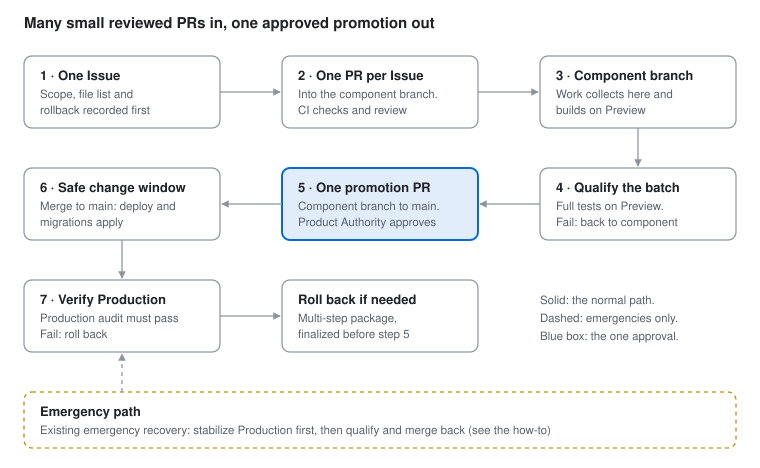

# Planned release process for 2027 (proposal)

This document proposes how LGFC moves planned changes to Production during 2027. It changes no rule and no setting. Until Product Authority approves it and a separate governance pull request adopts it, `docs/governance/DELIVERY-AND-RELEASE.md` is the only authority.

## The short version

Many small, reviewed pull requests are collected and tested together on a component branch and its Preview. They reach Production as one promotion pull request, which Product Authority approves, merged inside a safe change window.

The mechanism already exists. It is Model B in `docs/governance/DELIVERY-AND-RELEASE.md`. This proposal makes Model B the default for planned 2027 work and adds what Model B does not define: a release calendar, a safe change window, blackout days, and a change assessment.

## Direction this proposal follows

Product Authority, 2026-11-19 (#4764):

- The website freeze, with no changes allowed, begins 2027-01-01.
- Targeted changes will still be needed in phases through 2027. Each is assessed rigorously.
- Code is built and tested as packages on non-production Preview.
- Packages are promoted to Production as single larger blocks, all at one time, inside a safe change window.

The 2027 dates the process supports:

| Date | Event |
| --- | --- |
| 2027-01-01 | Website production launch |
| 2027-02-01 | Fundraiser announcement |
| 2027-03-25 | Fundraiser launch begins (runs to 2027-06-07); auction announcement |
| 2027-05-28 | Auction launch begins (runs to 2027-06-07) |
| 2027-06-08 | Activity wrap-up: fundraiser total and prize winners (later if information is slow to aggregate) |

## What already exists

| Need | Existing mechanism | Where it is defined |
| --- | --- | --- |
| Collect many reviewed changes before Production | Model B: child PRs into `component/<release-unit>` | `docs/governance/DELIVERY-AND-RELEASE.md` |
| One Production approval for the whole batch | Model B promotion PR from the component branch to `main` | `docs/governance/DELIVERY-AND-RELEASE.md` |
| A qualification barrier before Production | Promotion Candidate profile and Go/No-Go | `docs/governance/DELIVERY-AND-RELEASE.md` |
| Step-by-step procedure | Run Model B component release | `docs/how-to/delivery/run-model-b-component-release.md` |
| Rollback | Multi-step rollback package, finalized before the promotion PR | `docs/how-to/delivery/run-model-b-component-release.md` |
| Preview data isolation | Preview and component deploys bind the development database `lgfc-litedev` | `docs/reference/platform/component-environment-isolation.md` |
| Emergencies | Emergency recovery, stabilize first | `docs/how-to/ops/run-emergency-recovery.md` |

## What this proposal adds

1. **Model B is the default for 2027 planned work.** A change that is not an emergency and not documentation-only goes into a release unit. Model A (one PR straight to `main`) is kept for work that cannot wait for a window.
2. **One release unit per planned milestone.** For example one for the launch (before 2027-01-01) and one for each date in the table above, each with its own component branch and project/master Issue.
3. **A safe change window.** Promotion PRs merge to `main` only inside the window. How often it opens, who sets it, and which days it avoids are open decisions below.
4. **Blackout days.** Days when no promotion may merge, for example while the fundraiser or an auction is running.
5. **A change assessment.** From 2027-01-01 every change entering a release unit is assessed before it is accepted, and the assessment is recorded on its Issue. What the assessment asks is an open decision below.

## The steps

These are the Model B steps in plain order. The how-to has the detail.

1. **One Issue.** The Issue records scope, the file list, acceptance and rollback before work starts.
2. **One pull request per Issue.** Child PRs target the component branch. CI checks and independent review run as they do today. A child that touches a protected stop (`.github/CODEOWNERS`, `wrangler*.toml`, `functions/api/auth/**`, or a workflow that reaches secrets or Production) needs independent review before it integrates. Other protected paths (for example `migrations/**`, `scripts/ci/**`, `functions/api/admin/**`, `docs/governance/**`) integrate into the component branch automatically and are reviewed on the promotion PR, which needs an independent approved review when its diff still contains them.
3. **Collect on the component branch.** Merged work builds on a Preview. It does not reach Production.
4. **Qualify the batch.** The whole set is tested together on Preview as a Promotion Candidate. A material failure returns the candidate to Development through new Issues and pull requests.
5. **One promotion pull request.** It promotes the exact approved candidate from the component branch to `main`, with no new feature work. Product Authority approves it.
6. **Merge in the safe change window.** The merge deploys the site. Database migrations are applied by `d1-migrations.yml`, which runs on a push to `main`, so under Model B they apply when the promotion PR merges.
7. **Verify Production.** The Production audit must pass. If it does not, the rollback package is run.

## The promotion pull request must show

- [ ] Every Issue and child pull request in the release unit, with links
- [ ] The exact candidate identity and the `main` commit it was last synchronized with
- [ ] Preview test results for the whole batch, with the date
- [ ] Each database change, its order, and a note that old and new code both work
- [ ] Evidence that each migration was applied and tested on `lgfc-litedev` before the promotion (see Database changes)
- [ ] The finalized multi-step rollback package and who runs it
- [ ] The change window
- [ ] The change assessment for each change in the unit
- [ ] Known risks and anything deliberately left out
- [ ] The Go/No-Go record

## Database changes

Batching raises one risk: a database change can reach Production data before the code that uses it. Two facts about the current setup shape the answer (checked against `.github/workflows/d1-migrations.yml` on 2026-11-19, Cursor feedback on #5367):

- `d1-migrations.yml` runs only on a push to `main`. On that push it applies migrations to Production (`lgfc_lite`) and to the development database (`lgfc-litedev`) in the same run.
- A child pull request that adds a migration and merges into a component branch therefore does not run that workflow. Until the promotion merges, `lgfc-litedev` does not have the new migration, so a Preview of the component branch runs new code against the old schema, and the migration is never tested before it reaches Production.

This is a gap in the proposal as first written, which assumed migrations could be tested on Preview first. The options, for a decision below:

1. **Manual step:** an operator applies the component branch's migrations to `lgfc-litedev` (`wrangler d1 migrations apply lgfc-litedev --remote --env preview`) before qualification, and records it in the promotion evidence.
2. **A component-scoped job:** a workflow that applies a component branch's migrations to `lgfc-litedev` when a child merges. It reaches a database with a secret, so it is a protected stop and needs its own Issue and review.

Either way, `lgfc-litedev` is one database shared by every component branch and Preview. Two release units in flight at once would write their migrations to the same schema. The proposal therefore allows only one release unit with database changes in qualification at a time.

Each change is also written so old and new code both work (add first, remove in a later release). The isolation document says isolation is not claimed until the dashboard Preview `DB` binding matches `lgfc-litedev`; that is a hard gate before the first release unit is named, not a reminder.

## Emergencies

An emergency is Production unavailable, unsafe or materially degraded. It follows the existing emergency recovery procedure, which stabilizes first and does not wait for a window. The result is merged back into the active component branch the same day so the next promotion does not undo it.

## What must happen before this is used

Each item needs its own Issue and pull request. Items 1 and 4 need an explicit Go.

1. Confirm that the dashboard Preview `DB` binding matches `lgfc-litedev` (Production-side check, Product Authority or a read-only verification). This is a hard gate before the first release unit is named.
2. Decide the open items below.
3. Name the first release unit and open its project/master Issue.
4. Adopt the calendar, window, blackout and assessment rules in `docs/governance/DELIVERY-AND-RELEASE.md` through a Production-tier governance pull request.
5. If the window is to be enforced by a check, add a check on promotion PRs (head `component/**`, base `main`) that fails outside the window or on a blackout day. Run it as report-only for one release, then make it required. It needs its own Issue and a Production-tier change.
6. Choose how migrations reach `lgfc-litedev` during the child phase (see Database changes).

## Open decisions for review

| # | Decision | Proposal |
| --- | --- | --- |
| 1 | Window frequency | Open: a fixed recurring slot, or a slot set before each release. |
| 2 | Blackout days | Open: which fundraiser and auction days no promotion may merge. |
| 3 | What the change assessment asks | Open: for example risk, test evidence, rollback and whether it can wait for the next unit. |
| 4 | Who may declare an emergency | Product Authority only. |
| 5 | Start date | After the 2027-01-01 launch, so deployment practice does not change during Go/No-Go. |
| 6 | What stays on Model A | Only work that cannot wait for a window. Documentation-only work stays on Model C. |
| 7 | Window enforcement | A check on promotion PRs, report-only for the first release, then required. Without it the window is a rule followed by the approver, which does not block a mistaken merge. |
| 8 | Migrations during the child phase | Open: a manual step with recorded evidence, or a component-scoped job (a protected stop). Only one release unit with database changes in qualification at a time. |
